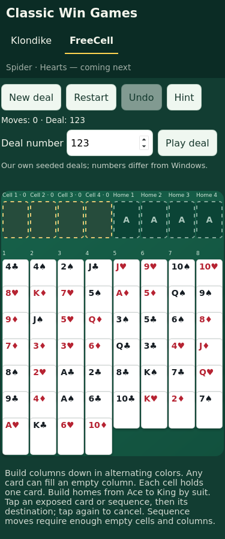

# FreeCell

FreeCell shares the card/grid renderer, navigation, selection, Undo, persistence
and offline shell with Klondike. Select FreeCell in the game navigation or open
`/#freecell` (under the project's Pages path).

## Rules and scope

- All 52 cards are face up, dealt round-robin into eight columns (7/7/7/7/6/6/6/6).
- Four free cells each hold one exposed card. Any card may fill an empty column.
- Build columns down by alternating color; homes ascend by suit from Ace to King.
- Home moves are final, with Undo available during the current play session.
- An ordered sequence moves only if enough temporary space exists:
  `(empty cells + 1) * 2 ** usable empty columns`. An empty destination is excluded;
  a source that becomes empty is not counted as available beforehand.
- Hints identify a legal local move, not a solution or a guarantee of winning.
- New deal, Restart, numbered replay, Undo and separate per-game saves are available.
  Undo history clears on refresh or game switching; the current board persists.
- Deals use this project's deterministic shuffle, **not Microsoft's deal numbering**.
  Accepted numbers: 1–2147483647. Solvability is not guaranteed.
- No automatic foundation moves, solver, timer or scoring beyond move count.

Rule references checked October 29, 2026:
[Brainium's FreeCell rules](https://brainium.helpshift.com/hc/en/8-freecell/faq/334-how-do-i-play-freecell/)
and [Matt Neuburg's sequence explanation](https://www.apeth.com/FreeCellHelpHTML/rules5.html).
No Microsoft artwork or source code is used.

## Implementation

`src/freecell.js` contains immutable, DOM-independent rules and saved-state
validation. `src/board.js` renders cards and naturally sized overlapping columns
for both games. `src/app.js` selects a rules engine from the URL fragment and
maintains independent `classic-win-freecell-v1` / `classic-win-klondike-v1` saves.

The narrow-screen FreeCell layout retains eight columns and 44px exposed face-up
strips. At 375px, reduced outer padding and 2px column gaps allow card widths of
at least 44px. Long columns grow the board and scroll vertically. Reserved cells
and homes have distinct captions and empty-pile colors. New rule/renderer modules
are included in the content-versioned precache for offline navigation.

## Verification

Run `npm ci && npm test`; then install Chromium/WebKit and run
`npm run test:browser`. New tests cover seeded decks, capacity boundaries,
non-mutating legal/illegal moves, cells, foundations, win/Undo, hints, corrupt saves,
touch actions, numbered replay/restart/new deal, save isolation, offline switching,
and initial/long-column geometry/screenshots at 375×667, 390×844, 430×932,
768×1024 and 1440×900. The existing Klondike and deployment-update checks remain.

[CI run 41006354131](https://github.com/jschell/classic-win-games/actions/runs/41006354131)
passed **20 unit tests and all 40 Chromium/WebKit browser tests** without retries
at source commit `b95603bf38a98c00efa514134e74ff1e4e9d689e` (33.6 seconds for browsers).
This includes all 20 existing Klondike/update cases and 20 FreeCell cases.

| Viewport | Initial and long columns, Chromium | Initial and long columns, WebKit |
|---|---|---|
| 375×667 | Passed | Passed |
| 390×844 | Passed | Passed |
| 430×932 | Passed | Passed |
| 768×1024 | Passed | Passed |
| 1440×900 | Passed | Passed |

Reviewed real rendered screenshots: eight columns fit, ranks/suits remain visible,
exposed face-up strips and card widths meet 44px at the tested sizes, and bottom
cards stay inside the naturally growing board. Phone layouts use normal vertical
page scrolling to reach lower cards and controls.

The first run caught an actual shared-worker defect: an offline reload at
`#freecell` could miss the cached root document because the FetchEvent URL
retained its fragment. The worker now removes fragments before matching both
games' shell URLs. Unit tests cover fragment URLs; both browser engines passed
FreeCell offline reload, game switching and reconnection with server connections
cut. The existing two-tab failed/successful worker replacement tests also passed.

Permanent screenshots:
[375px WebKit initial](evidence/freecell-webkit-375.png),
[375px WebKit long columns](evidence/freecell-webkit-375-long.png),
[1440px Chromium initial](evidence/freecell-chromium-1440.png).

Physical iPhone Safari and Home Screen installation remain device checks; Linux
WebKit coverage does not establish those results.
