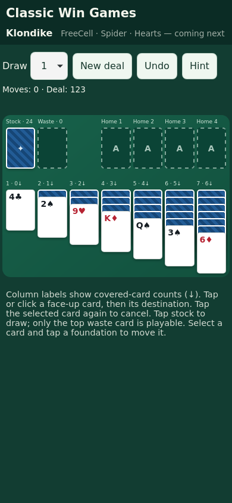

# Klondike mobile remediation and verification

Review date: October 29, 2026 (Pacific). Baseline: `c66ac3c6cfc42100d4003a9a79ac83804046913e`.

## Production

Production loaded in the remote Chrome browser. HTTP 200; downloaded `style.css`, `src/app.js`, and `sw.js` match baseline files byte for byte (SHA-256 comparison). PR #4 corner markup is present in the rendered DOM. GitHub Test run 40996197898 and Pages build/deployment run 40996197131 succeeded for this SHA. Repository reports `has_pages=true`; only Test is a checked-in workflow. The Pages configuration endpoint returned 404 without API authentication, so the source-directory configuration could not be independently inspected. The successful Pages run establishes deployment of this commit.

Browser interaction also confirmed Draw 3, Undo of a stock draw, and refresh restoration (with session-only Undo history cleared). A club Ace moves from tableau to foundation and reveals the covered card; the DOM shows one foundation card. Repeatedly tapping the selected Ace leaves it selected (defect reproduced). Remote browser viewport was 1363 × 936. Initial tableau containers measured 390px high regardless of stack contents.

## Defects and corrections

| Severity | Defect | Root cause and reproduction | Correction |
|---|---|---|---|
| High | Long tableau can outgrow its reserved area | Absolute-positioned cards; fixed column heights. Progress to long face-up sequences; desktop steps of 38px already exceed a 390px container at 8+ cards. Source/geometry finding; long-game visual reproduction pending. | Grid tracks reserve covered/face-up strips and the full last card; normal page scrolling. |
| Medium | Selected card cannot be deselected | Same-source move fails, then click handler immediately selects the card again. Confirmed in live browser. | Second tap clears selection; selected sequences and accessible pressed state are exposed. |
| Medium | Stock, waste and foundations lack visual separation | Six piles fill the first six slots of a seven-column grid. | Foundation group begins in column four, with labels/counts. |
| Medium | Undo and Draw selector can disagree | Mode changes mutate a state object held by history; render does not sync selector on undo. | Immutable preference update and retention of current Draw mode across undo. |
| High | Mixed shell versions and unbounded online wait | v3 network-first fetches each asset independently; worker activation does not reload open clients; every navigation can wait indefinitely on a stalled network. | Cache-first complete versioned shell; update bypasses HTTP cache, activates after precache, reloads persisted game on replacement. |
| Medium | Worker deletes unrelated origin caches | Activation deletes every cache except itself. Other GitHub Pages apps share this origin. | Delete only `classic-win-games-` caches. |
| Medium | Invalid saves can reach rendering | Validation checked only 52 unique IDs. | Validate shape, canonical cards, orientations, sequences and foundation order. |
| Low | Manifest lacks install icons | Empty icons array. | Original 192px/512px icons and apple-touch-icon. |

Foundation top-only rendering was already corrected and is retained. No claim that the original iPhone screenshot defect reproduced exactly: native Safari and resized production screenshots were unavailable.

## Implementation

- `src/app.js`: natural grid stack rendering, pile captions, separated foundations, repeat-tap cancellation, sequence highlight, save failure notice, immutable Draw preference, worker update handling (navigation, reconnection, focus, visibility and hourly checks).
- `style.css`: replace conflicting overrides with one responsive card/grid system. Face-up strips expose 44px; covered strips are 12–18px. Card width follows the seven-column grid; long columns scroll vertically instead of shrinking labels.
- `src/klondike.js`: saved-state validation; traditional move rules remain unchanged.
- `tools/build-sw.mjs`, `tools/service-worker.template.js`, `sw.js`: shell content hash, atomic installation, cache ownership and cache-first serving. `npm test` rejects an out-of-date generated worker. Run `npm run build:sw` after shell edits.
- `manifest.webmanifest`, `index.html`, `icons/`: original install assets and interaction/status labels.
- `tests/`, `playwright.config.js`, `tools/serve.mjs`, `.github/workflows/test.yml`: deterministic rules, mocked worker lifecycle, real Chromium/WebKit tests with touch input, screenshots, traces and HTML report. Playwright is a development dependency only; no runtime dependencies/CDNs/backend.

## Verification and limitations

Run `npm ci && npm test`. Browser suite: `npx playwright install --with-deps chromium webkit && npm run test:browser`.

Browser suite covers 375×667, 390×844, 430×932, 768×1024 and 1440×900: initial deal, six covered cards plus a 13-card face-up run, horizontal overflow, column/bottom containment, exposed labels, 44px face-up targets, foundation separation and screenshots. Gameplay cases cover Draw 1/3, recycling, valid/invalid moves, waste-to-tableau/foundation, tableau-to-foundation, sequences, reveal, King-to-empty, repeated taps, deselection, Undo, saved-game restore and new deal. Offline shell/reconnection are exercised through real service workers on localhost.

Remote browser screenshot capture repeatedly timed out. Its API provides no viewport resize, and local-file navigation was policy-blocked. Local Playwright browser installation failed because downloads were invalid/truncated archives. These limits did not prevent CI verification: GitHub Actions installed the browsers successfully. CI artifacts retain screenshots and failure traces for 14 days.

### Completed CI verification

Source commit `a162a980b48341d74b2340485573818cef52e93f`: [Test run 41000033246](https://github.com/jschell/classic-win-games/actions/runs/41000033246) passed both jobs. All **12 Node tests** and **20 browser tests** passed; browser tests completed in 15.7 seconds without retries. The seeded draw test covers 6,000 state transitions.

| Viewport | Chromium initial/long | WebKit initial/long |
|---|---|---|
| 375 × 667 | Passed | Passed |
| 390 × 844 | Passed | Passed |
| 430 × 932 | Passed | Passed |
| 768 × 1024 | Passed | Passed |
| 1440 × 900 | Passed | Passed |

Both engines passed the full touch interaction puzzle, Draw 1/3/recycle/repeated taps, invalid moves, new deal, Undo and restoration. Both passed offline reload/reconnection when the test server destroyed incoming sockets, and a two-tab failed-then-successful deployment update with persisted-game preservation. Playwright's WebKit `setOffline` simulation produced internal navigation errors; the final tests use actual server connection failures instead.

Reviewed the rendered screenshots, including the 375px WebKit long sequence and 390px WebKit initial deal. Rank/suit identifiers remain visible; all seven columns fit; separate back strips show covered cards; the full last card stays inside the growing board. Long columns require normal vertical page scrolling. Test taps target the exposed corner of covered face-up cards, rather than their obscured centers. A separate restored-page viewport is explicitly set before each long-column test.

Selected permanent evidence:

- [390px WebKit initial deal](evidence/webkit-390-initial.png)
- [375px WebKit long column](evidence/webkit-375-long.png)
- [1440px Chromium initial deal](evidence/chromium-1440-initial.png)

Native iPhone Safari, standalone installation, real GitHub Pages deployment replacement, background suspension and storage eviction require additional device verification. The two-tab replacement path is verified on isolated local test origins in both engines. WebKit on Linux is useful engine coverage, not a physical iPhone test. Draw 3 intentionally displays only the playable top waste card. Undo history remains session-only; the current game persists. Hint remains foundation-focused. No additional games implemented.

## Subsequent gameplay review fixes

Draw changes now require a confirmed new deal. Undo persists up to 100 actions
per game. Desktop drag/drop, double-click-to-home and a proven foundation-only
Finish are available; hints are explicitly local nudges. The older observations
above describe the commits named there, rather than current feature limits.
