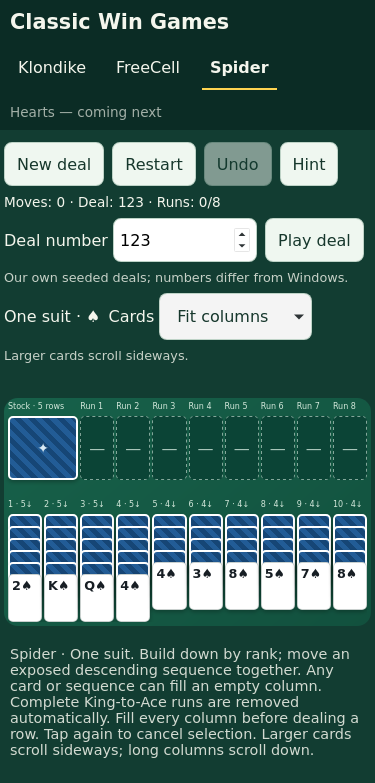

# Spider Solitaire — one, two and four suits

Open `/#spider` under the project's Pages path or choose Spider in navigation.
Choose **Suits** to play one suit (spades), two suits (spades/hearts), or four
suits. Every mode uses 104 distinct IDs: eight copies per rank in one suit, four
per rank/suit in two suits, and two per rank/suit in four suits. Red hearts and
diamonds retain their symbols so color is not the only identifier.

The same seed and suit count reproduce a deal using our own shuffle. One-suit
deals are unchanged from earlier versions. Numbers do not match Windows and
solvability is not guaranteed.

## Rules

- Ten columns receive 54 cards: six in the first four, five in the remaining six.
  Only the last card in each starts face up; 50 cards remain in stock.
- Build columns down by rank. An exposed descending same-suit sequence moves
  together with no FreeCell-style capacity limit. Any card or valid sequence
  may fill an empty column. A sequence can land on the next higher rank of any suit. Mixed-suit
  runs cannot move as a group; move their same-suit suffixes separately.
- Stock deals one face-up card onto each column, in order, for five rows. Every
  column must contain a card before a row can be dealt. No unrestricted-deal rule.
- A complete same-suit King-to-Ace run is removed automatically. Exposed covered
  cards flip face up, including after removal; newly exposed full runs also clear.
  All eight completed runs win. Completed runs are display-only.
- Undo reverses an entire action, including a stock row, run removal and reveals.
  History is session-only and resets when refreshing or switching games. Each
  game's current board persists independently. Each Spider suit mode also has
  its own board and hint trail. Switching modes resumes that board and clears
  session Undo, just like switching games; it does not discard other boards.
- Restart and numbered replay preserve the current suit mode and seed. Hints
  evaluate reveals, completed runs, space and same-suit joins, including bounded
  setup search and recent-position loop filtering; they are not a solver. See
  [hint evaluation](hints.md).

Rule references checked October 30, 2026:
[MobilityWare rules](https://mobilityware.helpshift.com/hc/en/11-spider/faq/586-how-do-i-play-spider-solitaire/)
and [Arkadium rules](https://support.arkadium.com/en/support/solutions/articles/44001813711--spider-solitaire-how-to-play-tips-settings-scoring).
Artwork is original; no Microsoft code or assets are included.

## Mobile presentation

Ten 44px cards cannot all fit across a 375px viewport. Spider has two explicit
views, remembered independently of game state:

- **Fit columns:** shows all ten columns; phone cards are narrower than 44px,
  while exposed face-up strips remain 44px high and corner ranks/suits stay visible.
- **Larger cards:** minimum 52px-wide cards in a horizontally scrollable board
  on phones. Selection remains active while scrolling to a destination. The page
  itself does not overflow horizontally. Long columns grow vertically with the page.

Both views reuse the shared natural-height card grid. Stock and completed-run
markers remain above the scrolling columns. Covered strips/counts stay distinct.

## Implementation and verification

`src/spider.js` provides immutable rules, seed handling, local hints and strict
104-card save validation. `src/board.js` reuses card rendering and adds completed
run markers. `src/app.js` routes `#spider`, keeps independent saves, and reuses
New deal, Restart, Undo and numbered replay. The existing content-versioned worker
precaches the Spider module and supports fragment navigation offline.

`npm test` runs rule/worker checks; `npm run test:browser` runs Chromium and WebKit.
Spider tests cover initial 54/50 deals, duplicate ranks with unique IDs, legal and
illegal sequences, reveals, stock row order/exhaustion/empty-column blocking,
completed runs and cascades, eighth-run win/Undo, corrupt saves, hints, seed replay,
state isolation, both card views, horizontal selection and offline reconnection.
Initial and long columns are exercised at 375×667, 390×844, 430×932, 768×1024 and
1440×900. Existing Klondike, FreeCell and worker-update tests remain in the suite.

[CI run 41066400605](https://github.com/jschell/classic-win-games/actions/runs/41066400605)
passed all **30 unit/worker tests and 62 browser tests** without retries at source
`61a5f0e0dfa2276f1d6d1fbfd13e6e31f34697c6` (55.4 seconds for browsers). This retains
all 40 existing browser regression cases and adds 22 Spider cases.

| Viewport | Chromium fit/large, initial/long | WebKit fit/large, initial/long |
|---|---|---|
| 375×667 | Passed | Passed |
| 390×844 | Passed | Passed |
| 430×932 | Passed | Passed |
| 768×1024 | Passed | Passed |
| 1440×900 | Passed | Passed |

Reviewed the real 375px WebKit initial and long-column images, plus desktop
Chromium. All ten columns and identifying ranks/suits fit in overview; the bottom
cards remain inside the growing board. Tests also verify that larger-view cards
exceed 44px width, only the inner region scrolls sideways, and a selected sequence
survives scrolling to an invalid destination and then making a legal move.

Permanent evidence: [375px overview](evidence/spider-webkit-375.png),
[375px long columns](evidence/spider-webkit-375-long.png), and
[1440px desktop](evidence/spider-chromium-1440.png). CI also captures Larger cards.

Known interaction tradeoffs are narrower overview targets, horizontal panning in
the larger view, page scrolling for very long stacks, local rather than solving
hints, and session-only Undo. These are explicit rather than changed game rules.

Native iPhone
Safari, standalone installation and real touch scrolling remain device checks;
Linux WebKit results do not establish physical-device behavior. A solver, a
timer and additional scoring remain outside this version.

## Multi-suit extension

The mode selector remembers the most recently selected suit count. The original
`classic-win-spider-v1` board stays in place for one suit. Two/four suits use
`classic-win-spider-2-v1` and `classic-win-spider-4-v1`; hint trails have the same
per-board separation. No old save is rewritten into a different deck. Saves
validate each ID against the selected mode's canonical suit/rank/color mapping,
including completed runs. Invalid or mismatched saves fall back to a new deal in
the selected mode. Unsupported modes are rejected by the pure rules API.

The existing move/settle rules now operate on parameterized decks. Red completed
run markers display their suit and expose suit names to screen readers. Hints
already count same-suit joins; candidate generation never treats a mixed-suit
suffix as movable. Suit count is also included in position identity.

`tests/spider-suits.test.js` adds 13 unit cases: deck distributions, invalid modes,
seed replay, mixed/same-suit movement, rank-only destination placement, run
completion and rejection, reveal/Undo snapshots, final win, stock exhaustion,
save validation and 20 seeded hint walks per added mode without repeated
positions. All **52 unit tests pass locally**.

`tests/browser/spider-suits.spec.js` adds 16 scenarios per browser (32 checks
in Chromium/WebKit), bringing the suite to 108: initial/mixed long columns at
all five viewports, red/black rank/suit readability, fit/larger views, touch
moves/rejection, hint choices, same-suit completion, final win/Undo, separate
legacy/mode saves, remembered preference, replay/Restart, invalid preference/save recovery, blocked storage and offline switching.
Browser execution results and screenshots are recorded in the PR after CI.
